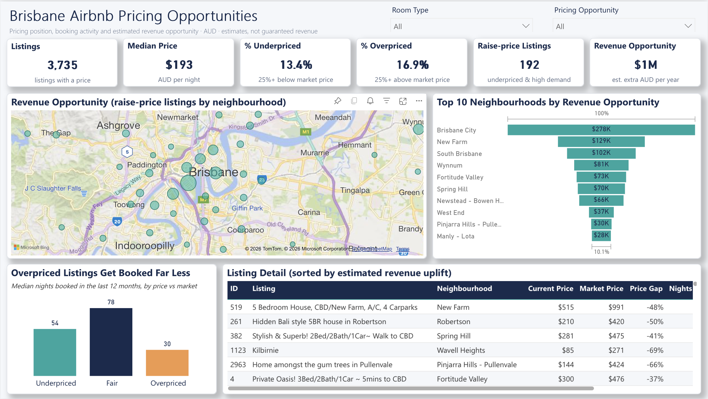
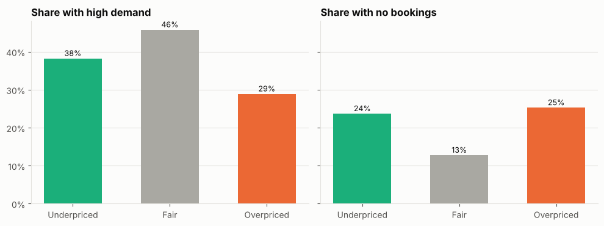

# 🏠 Brisbane Airbnb Pricing: Prediction & Opportunities

Predicting nightly Airbnb prices in Brisbane, then comparing each listing with a market price benchmark to find who is priced too low or too high, and how much hosts could earn by adjusting. Built as an academic project at Macquarie University (Master of Business Analytics) and finished with an interactive Power BI dashboard.



## 🏆 Key results
| | Finding |
|---|---|
| 🥇 **Kaggle** | 4th place in the class competition, cutting prediction error from 23.5% to 4.2% (MAPE) |
| 📏 **Market benchmark** | Estimates a fair price from listing characteristics alone with a median error of 16% |
| 💰 **Underpriced** | 192 listings charge ~35% less than comparable listings yet are booked a median of 180 nights a year |
| 📈 **Opportunity** | Closing half that gap is worth an estimated **~$1.5M a year** (+26% for those hosts) |
| 📉 **Overpriced** | Listings priced 25%+ above the market are booked a median of only **30 nights** a year, vs **78** for fairly priced ones |

## 📊 Power BI dashboard
**File:** [`powerbi/AirbnbPricing.pbix`](powerbi/) <!-- add the Publish-to-web link here if available -->

One-page dashboard for a pricing team or host, with Room Type and Pricing Opportunity slicers that filter every visual:
- **KPI row:** listings, median price, % underpriced, % overpriced, raise-price listings, estimated revenue opportunity.
- **Map:** where listings and opportunities sit across Brisbane.
- **Top 10 neighbourhoods** by estimated revenue opportunity.
- **"Overpriced listings get booked far less":** median nights booked by price position (Underpriced 54 · Fair 78 · Overpriced 30).
- **Listing detail table** sorted by estimated revenue uplift.

Built with a single listing-level table, DAX measures (e.g. ranking neighbourhoods inside the current filter context), custom sort order and a consistent colour scheme (teal = underpriced, grey = fair, orange = overpriced).

## 🤖 Part 1 – Price prediction
**Notebook:** [`01_airbnb_price_prediction.ipynb`](01_airbnb_price_prediction.ipynb)

- Cleaned and prepared 5,300+ listings across 65 fields in Python (pandas, NumPy).
- Benchmarked KNN, Random Forest and XGBoost with five-fold cross-validation and hyperparameter tuning.
- Final hybrid approach combined CatBoost with rule-based price estimates to place 4th in the class Kaggle competition.

## 💡 Part 2 – Pricing opportunities
**Notebook:** [`02_pricing_opportunity_analysis.ipynb`](02_pricing_opportunity_analysis.ipynb)

**Question:** Which listings are priced below or above comparable listings, and where could hosts earn more?

1. **Market price benchmark:** a gradient boosting model estimates what each listing *should* charge from its characteristics only (location, size, property type, amenities, reviews, host profile). Booking and revenue fields are excluded, and every listing is scored out-of-fold.
2. **Price gap:** listings more than 25% below or above their market price are flagged as underpriced or overpriced.
3. **Demand check:** nights booked in the last 12 months separate real pricing opportunities from listings with other problems.



| Action group | Listings | What it means |
|---|---|---|
| **Raise price** | 192 | Underpriced and in high demand: test a higher price |
| **Lower price** | 450 | Overpriced and rarely booked: review the price |
| **Premium justified** | 183 | Above the market but still in high demand: keep the premium |
| **Fix the listing** | 310 | Cheap but still not booking: price is not the issue |

**Other insights**
- **Cheap ≠ booked:** underpriced listings book *fewer* nights than fairly priced ones, so a low price often compensates for something else (photos, reviews, condition).
- **Mispricing is listing-level, not suburb-level:** every large neighbourhood sits within −7% to +5% of the market. Wynnum has the highest share of underpriced listings (27%).
- **Property type, neighbourhood and size** set most of the market price.

## 📦 Tools
Python (pandas, NumPy) · scikit-learn · XGBoost · CatBoost · Matplotlib · Seaborn · Power BI (DAX) · Jupyter Notebook

## 📁 Repository structure
```
├── data/
│   └── README.md                            # data source and key fields (raw CSVs not committed)
├── exports/                                 # listing- and neighbourhood-level results used by the dashboard
├── images/                                  # dashboard screenshot and charts used in this README
├── powerbi/
│   └── AirbnbPricing.pbix                   # Power BI dashboard
├── 01_airbnb_price_prediction.ipynb         # EDA, cleaning, model comparison, Kaggle submission
├── 02_pricing_opportunity_analysis.ipynb    # market benchmark, price gaps, demand, opportunities
├── requirements.txt
└── README.md
```

## ▶️ How to run
1. Clone the repo and install dependencies: `pip install -r requirements.txt`
2. Place `train.csv` and `test.csv` in the `data/` folder (see [`data/README.md`](data/README.md)).
3. Open a notebook in Jupyter and choose **Run → Run All Cells**. Notebook 02 writes the dashboard data to `exports/`.
4. Open `powerbi/AirbnbPricing.pbix` in Power BI Desktop to explore the dashboard.

## ⚠️ Limitations
- The market benchmark has a median error of 16%; it cannot see photos, condition or seasonal events.
- Prices are a single snapshot; real Airbnb prices change by date.
- The revenue opportunity is an estimate: it assumes bookings stay the same after a price rise, so only half the gap is used to keep it cautious.
- Nights booked are Inside Airbnb estimates, not actual booking records.

## 👤 Author
**Paige (Ha Phuong Dinh)** · [LinkedIn](https://www.linkedin.com/in/your-profile)
